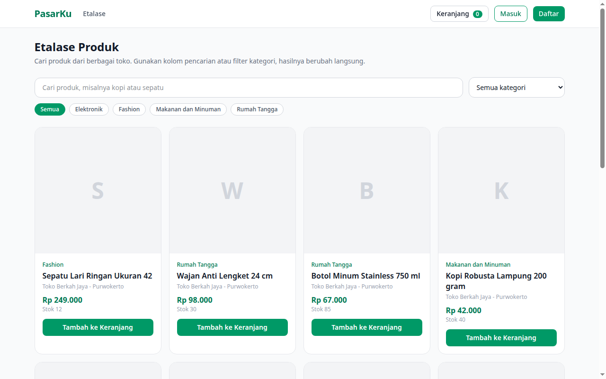

# Marketplace Laravel Vue (PasarKu)

PasarKu adalah aplikasi marketplace berbasis web yang dibangun dengan Laravel 12 dan Vue 3. Pengguna dapat berbelanja produk dari berbagai toko, dan setiap akun juga dapat membuka satu toko untuk menjual produknya sendiri. Seluruh alur utama marketplace tersedia dan berfungsi, mulai dari pendaftaran akun, pembuatan toko, pengelolaan produk, keranjang belanja, checkout, sampai pengelolaan status pesanan oleh penjual.

## Fitur

- Autentikasi web berbasis sesi: daftar, masuk, dan keluar
- Satu akun berperan ganda sebagai pembeli dan pemilik toko
- Pembuatan dan pengelolaan profil toko (nama, deskripsi, kota, alamat, telepon, kode pos)
- Kategori produk yang dapat ditambah dan dihapus oleh penjual
- CRUD produk untuk pemilik toko: nama, kategori, harga, stok, deskripsi, foto dari URL atau unggahan berkas, serta status aktif
- Etalase publik berisi katalog produk interaktif berbasis Vue 3 dengan pencarian dan filter kategori yang berubah secara real-time
- Halaman detail produk dengan form tambah ke keranjang
- Keranjang belanja berbasis sesi: tambah, ubah jumlah, hapus item, dan hitung total otomatis
- Checkout yang membuat pesanan beserta itemnya dan mengurangi stok produk
- Status pesanan sederhana: baru, diproses, selesai, dan batal
- Halaman Pesanan Saya untuk pembeli dan daftar Pesanan Masuk untuk pemilik toko dengan fitur ubah status
- API JSON internal untuk daftar produk, kategori, dan keranjang yang dipakai komponen Vue
- Data contoh siap pakai lewat seeder: 4 kategori, 1 toko, 9 produk, dan 2 akun demo

## Teknologi

- PHP 8.2 atau lebih baru
- Laravel 12
- Vue 3 dan Vite dengan plugin Vue resmi
- Tailwind CSS 4
- SQLite sebagai database bawaan (dapat diganti MySQL lewat konfigurasi .env)
- UUID sebagai kunci utama seluruh tabel utama

## Akun Demo

Setelah menjalankan seeder, dua akun berikut dapat dipakai untuk mencoba aplikasi. Kata sandi keduanya adalah `password`.

- Pemilik toko: `penjual@demo.test`
- Pembeli: `pembeli@demo.test`

Akun demo hanya untuk mencoba aplikasi di lingkungan lokal.

## Cara Instalasi

Prasyarat:

- PHP 8.2 atau lebih baru beserta ekstensi umum Laravel (mbstring, xml, curl, sqlite3, zip)
- Composer
- Node.js 20 atau lebih baru dan npm

Langkah instalasi:

```bash
git clone https://github.com/bintangyudhis/marketplace-laravel-vue.git
cd marketplace-laravel-vue
composer install
npm install
npm run build
cp .env.example .env
php artisan key:generate
php artisan migrate --seed
php artisan storage:link
```

Perintah `storage:link` hanya diperlukan bila memakai fitur unggah foto produk.

## Cara Menjalankan

Jalankan server pengembangan Laravel:

```bash
php artisan serve
```

Buka `http://localhost:8000` di browser. Etalase produk tampil di halaman utama dan katalog Vue langsung memuat daftar produk dari API internal.

Untuk pengembangan frontend dengan hot reload, jalankan Vite di terminal terpisah:

```bash
npm run dev
```

## Alur Penggunaan Singkat

1. Daftar akun baru lewat halaman Daftar, atau masuk dengan akun demo.
2. Buka menu Buka Toko untuk membuat toko, lalu tambahkan produk dari panel penjual.
3. Kembali ke etalase, cari produk, dan tambahkan ke keranjang.
4. Buka halaman Keranjang, isi data penerima, lalu buat pesanan lewat tombol checkout.
5. Pembeli memantau pesanan di halaman Pesanan Saya, sedangkan penjual mengubah statusnya dari menu Pesanan Masuk.

## API Internal

Endpoint JSON berikut dipakai oleh komponen Vue dan tersimpan di grup rute web agar sesi keranjang dan token CSRF berfungsi.

- `GET /api/products` dengan parameter opsional `q` untuk pencarian dan `category` untuk filter slug kategori
- `GET /api/products/{id}` untuk detail produk
- `GET /api/categories` untuk daftar kategori beserta jumlah produk
- `GET /api/cart`, `POST /api/cart`, `PATCH /api/cart/{productId}`, dan `DELETE /api/cart/{productId}` untuk isi keranjang sesi saat ini

## Pengujian

Jalankan rangkaian pengujian bawaan:

```bash
php artisan test
```

Pengujian mencakup halaman etalase, API produk dan pencarian, serta alur tambah keranjang sampai checkout dan pengurangan stok.

## Tangkapan Layar



## Lisensi

Proyek ini memakai lisensi MIT. Lihat berkas [LICENSE](LICENSE) untuk teks lengkapnya.
